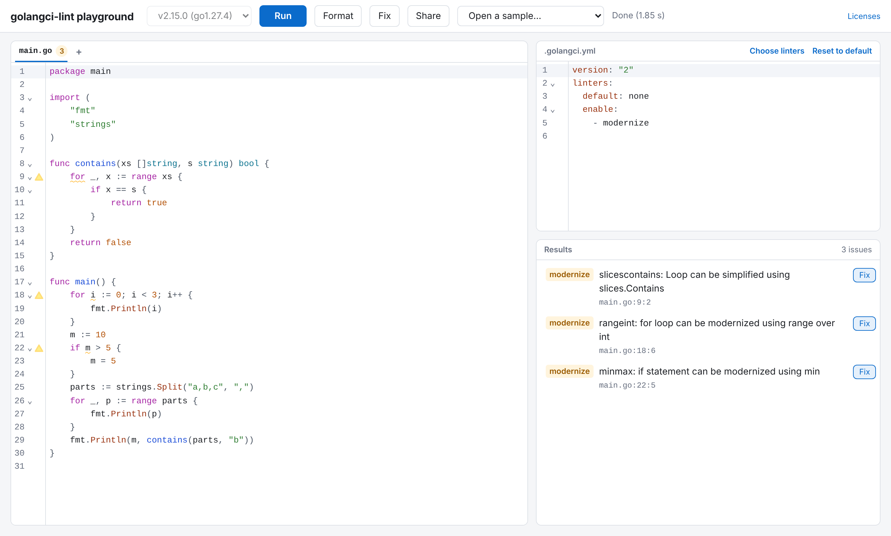

# golangci-lint-playground

A playground that runs [golangci-lint](https://golangci-lint.run/) entirely in the browser. Write Go code and a `.golangci.yml`, press Run, and a WebAssembly build of golangci-lint lints the code and shows the results in the editor. The code is never sent to a server.



## Features

- Linting with golangci-lint v2.15.0 (built with Go 1.27.4). The results are the same as with the native golangci-lint (checked by the tests in `testdata/parity/`)
- A free-form `.golangci.yml`: what you write is used as is, without being rewritten
- Completion, documentation and warnings for `.golangci.yml` (based on golangci-lint's JSON Schema), and a dialog to choose linters and formatters from a list (it rewrites only the affected part of the YAML)
- `Format` button (Shift+Alt+F): formats with goimports and adds missing imports
- `Fix` button: fixes all auto-fixable issues (`golangci-lint run --fix`). Issues can also be fixed one by one from the results list or the editor
- Multiple files (in tabs) and packages within the same module
- Samples (`web/examples/`)
- Sharing by URL (the code and configuration are compressed into the part of the URL after `#`, which is never sent to the server)

## Limitations

- Only the standard library and packages of the same module can be imported (third-party modules are not supported)
- Tested with Google Chrome (desktop)
- The first visit downloads about 25 MB (later visits load it from the service worker's cache)
- Some features do not work in the browser: `gomoddirectives`, `gomodguard`, `gomodguard_v2`, gocritic's ruleguard and custom linters (plugins). The editor warns when the configuration uses them

See the [design document](docs/design.md) for details ([Japanese version](docs/design.ja.md)).

## Development

Requirements: Go (the toolchain in `wasm/go.mod` is downloaded automatically) and Node.js 22 or later.

```bash
cd web && npm ci
```

Build the WebAssembly golangci-lint, the standard library bundle and the analysis cache (takes a few minutes). The output goes to `wasm/dist/`.

```bash
./scripts/build-assets.sh
```

Development server:

```bash
cd web && npm run dev
```

Tests:

```bash
cd web && npm test
```

```bash
cd web && npm run parity
```

```bash
cd web && npm run build && npm run e2e
```

| Directory | Contents |
| --- | --- |
| `wasm/` | Pipeline that builds golangci-lint for js/wasm (patches to `golang.org/x/tools`, standard library bundle) |
| `web/` | Web app (Vite + TypeScript + CodeMirror 6). `src/engine/` runs golangci-lint in a Web Worker |
| `testdata/parity/` | Test cases comparing the native and WebAssembly results (the samples in `web/examples/` are checked too) |
| `scripts/` | Asset build, design document sync check |
| `docs/` | Design document (`design.md` in English, `design.ja.md` in Japanese) |

On pushes to `main`, GitHub Actions runs the tests and deploys to GitHub Pages (set Settings → Pages → Source to "GitHub Actions").

Whether all CI jobs succeeded is reported as a single check, `CI success`. To protect `main`, require only `CI success` in the branch ruleset (Settings → Rules → Rulesets → "Require status checks to pass"). Adding or splitting jobs does not require changing the ruleset. Auto-merge (Settings → General → Allow auto-merge) waits for this check too.

## License

This repository is licensed under the [MIT license](LICENSE), except the patches to `golang.org/x/tools` in `wasm/xtools/patches/`, which are under the BSD-3-Clause license of `golang.org/x/tools` ([wasm/xtools/LICENSE](wasm/xtools/LICENSE)).

golangci-lint is licensed under the [GNU General Public License version 3](https://github.com/golangci/golangci-lint/blob/main/LICENSE). This repository contains none of its code, but the deployed playground distributes a WebAssembly build of it, so the build publishes, next to the binary in `v/<version>/`:

- `golangci-lint-source.tar.gz`: the complete source code the binary is built from (all modules vendored, including the patched `golang.org/x/tools`) with build instructions. `wasm/build.sh` builds the binary from exactly this tree, offline.
- `licenses.txt`: every module in the binary with its license, followed by their license, NOTICE and PATENTS files and Go's license.

The web app's own `licenses.txt` (at the site root) contains the MIT license and the licenses of the npm packages it bundles. The "Licenses" button in the playground links to all of these. See [section 12 of the design document](docs/design.md#12-licenses) for details.
