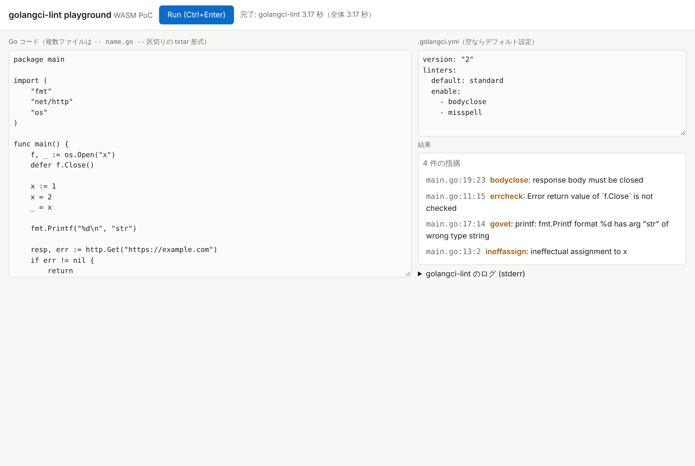

# golangci-lint playground — ブラウザ WASM PoC

golangci-lint（v2.5.0）を `GOOS=js GOARCH=wasm` でビルドし、**サーバーを使わずにブラウザ内だけで** Go コードを検査する PoC。



## 使い方

必要なもの: Go 1.24.x（`GOTOOLCHAIN=local` で使う。バンドルする標準ライブラリはこの Go のもの）、Node.js 22 以上。

```bash
./build.sh
```

```bash
node scripts/serve.mjs dist 8080
```

ブラウザで http://127.0.0.1:8080/ を開く。

E2E テスト（ヘッドレス Chromium、Playwright を使用）:

```bash
node scripts/e2e.mjs dist
```

## 仕組み

```
ブラウザ (メインスレッド)            Web Worker
┌──────────────────────┐  postMessage  ┌────────────────────────────────────────┐
│ index.html / app.js  │ ────────────▶ │ worker.js                              │
│  コード・設定の編集  │ ◀──────────── │  ├ MemFS (gofs.js) を globalThis.fs に │
│  結果表示            │   結果(JSON)  │  ├ wasm_exec.js (Go の公式ランタイム)  │
└──────────────────────┘               │  └ golangci-lint.wasm を実行ごとに起動 │
                                       └────────────────────────────────────────┘
```

| ファイル | 役割 |
| --- | --- |
| `xtools/defaultdriver-hook.patch` | `golang.org/x/tools/go/packages` に、`go list` の代わりに使うドライバのフックを追加する（数行） |
| `xtools/inproc_js.go` | js/wasm 用のプロセス内ドライバ。ユーザーのパッケージは `go/build` で、標準ライブラリはマニフェストから解決し、型情報は事前生成した export data を指す |
| `tools/mkbundle` | 標準ライブラリのソース・export data（`__.PKGDEF` のみ）・マニフェストを `std.bundle.gz` にまとめる |
| `web/gofs.js` | Go の `syscall/fs_js.go` が呼ぶ Node 互換 `fs` API のメモリ上の実装 |
| `web/runner.js` | golangci-lint の起動（環境変数・引数）、結果 JSON の正規化（`typecheck` の位置補正を含む） |
| `web/bundle.js` | バンドルの読み書き |
| `web/worker.js` / `web/app.js` / `web/index.html` | Web Worker と UI |
| `scripts/seed-cache.mjs` | ブラウザと同じ MemFS・同じパスで Node 上で golangci-lint を動かし、標準ライブラリ全体の解析キャッシュを `cache.bundle.gz` として生成する |
| `scripts/e2e.mjs` | Playwright による E2E テスト |

golangci-lint 本体には手を入れていない。`build.sh` が `golang.org/x/tools` をモジュールキャッシュからコピーしてパッチを当て、`-modfile` の `replace` で差し替えてビルドする。

## 計測結果

ヘッドレス Chromium、ローカルサーバー（回線速度の影響なし）での結果。サンプルコードは `errcheck`・`ineffassign`・`govet`（printf）・`bodyclose` の違反を含む。

| 項目 | 結果 |
| --- | --- |
| ダウンロードサイズ | 約 24.4MB（`golangci-lint.wasm.gz` 15.1MB、`std.bundle.gz` 9.0MB、`cache.bundle.gz` 0.3MB） |
| 初期化（展開・WASM コンパイル） | 約 0.8 秒 |
| 1 回目の検査（事前生成キャッシュあり） | 約 2.7〜3.2 秒 |
| 2 回目以降の検査 | 約 0.9 秒 |
| 1 回目の検査（事前生成キャッシュなし） | 約 22.6 秒 |
| 型エラーのみのコード | 約 0.4 秒 |

- 検出結果はネイティブの golangci-lint と一致する
- `.golangci.yml` に書いた設定はそのまま反映される（E2E で `default: none` + `govet` のみ、を確認）
- 型エラー（`typecheck`）は正しい行・列で表示される

## 既知の制約

- 依存は標準ライブラリのみ（サードパーティモジュールは非対応）
- `go` コマンドを内部で起動する機能は動かない（`gomoddirectives`、`gci` フォーマッタなど）。golangci-lint はエラーをログに出して処理を続ける（終了コードは 7 になる）
- ファイルロックが使えないため `--allow-parallel-runners` を付けて実行している
- 解析対象は linux/amd64、`CGO_ENABLED=0` として扱う
- UI はテキストエリアだけの最小構成（エディタ組み込み・共有機能などは本実装で行う）
- 確認したブラウザはヘッドレス Chromium のみ。Firefox・Safari・モバイルは未確認
